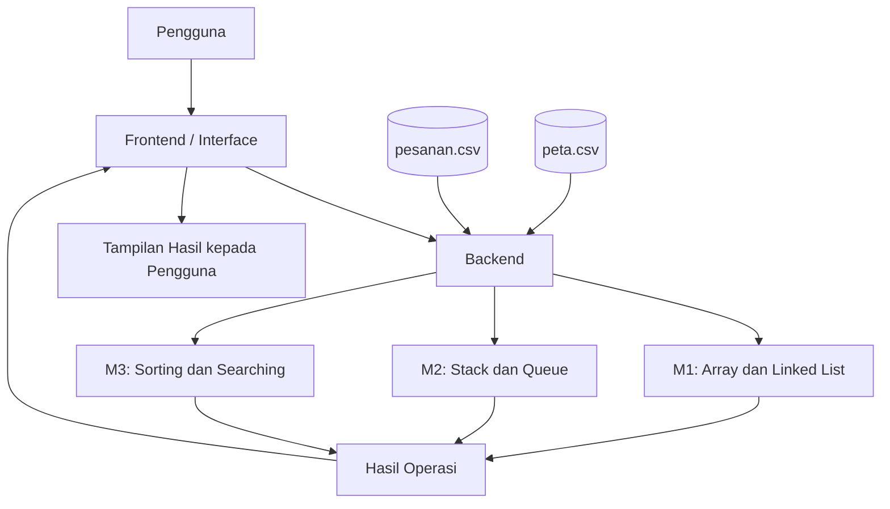

# 2EZ4U — Aplikasi Pengelolaan Pesanan

Aplikasi desktop berbasis Python yang dikembangkan untuk proyek mata kuliah **Struktur Data & Analisa Algoritma (EC234303)**. Proyek ini menerapkan berbagai struktur data dan algoritma untuk mengelola pesanan, memproses antrean, melakukan pengurutan, serta membandingkan efisiensi operasi.

---

## Daftar Isi

- [Deskripsi Proyek](#deskripsi-proyek)
- [Tujuan](#tujuan)
- [Tools dan Teknologi](#tools-dan-teknologi)
- [Struktur Folder](#struktur-folder)
- [Diagram Arsitektur](#diagram-arsitektur)
- [Fitur Utama](#fitur-utama)
- [Cara Menjalankan Aplikasi](#cara-menjalankan-aplikasi)
- [Format Data](#format-data)
- [Git dan Kontribusi](#git-dan-kontribusi)

---

## Deskripsi Proyek

**2EZ4U** merupakan aplikasi pengelolaan pesanan yang dirancang untuk mempelajari penerapan struktur data dan algoritma dalam kasus yang menyerupai proses operasional layanan makanan.

Aplikasi mengolah data pesanan dan menyediakan fitur untuk melihat, menambahkan, serta menghapus pesanan, mengelola antrean, membatalkan atau mengulangi aksi tertentu, dan menghasilkan hasil pengurutan maupun pencarian data.

Selain menjalankan fungsi pengelolaan data, proyek ini membandingkan beberapa pendekatan algoritmik berdasarkan waktu eksekusi, jumlah operasi, dan kompleksitasnya.

## Tujuan

1. Menerapkan struktur data seperti array, linked list, queue, dan stack.
2. Memahami perbedaan kinerja beberapa implementasi struktur data.
3. Mengimplementasikan algoritma sorting dan searching.
4. Mengamati jumlah operasi dan waktu eksekusi algoritma.
5. Mengintegrasikan backend pengolahan data dengan antarmuka desktop.
6. Mengelola data pesanan menggunakan berkas CSV.

---

## Tools dan Teknologi

| Komponen | Teknologi |
|---|---|
| Bahasa pemrograman | Python |
| Antarmuka pengguna | Python desktop UI; Tkinter digunakan pada implementasi antarmuka |
| Penyimpanan data | CSV |
| Code editor | Visual Studio Code |
| Version control | Git |
| Repository online | GitHub |
| Sistem operasi pengembangan | Windows |

### Struktur data dan algoritma

- Array
- Linked List
- Queue naif dan circular queue
- Stack untuk undo dan redo
- Insertion Sort
- Merge Sort
- Linear Search
- Binary Search

---

## Struktur Folder

```text
2EZ4U-ASGMNT/
│
├── back/
│   ├── M1_A+LL
│   ├── M2_
│   └── M3
│
├── front/
│   └── interface
│
├── data/
│   ├── pesanan.csv
│   └── peta.csv
│
└── README.md
```

### Penjelasan folder dan berkas

| Folder/Berkas | Fungsi |
|---|---|
| `back/` | Menyimpan implementasi struktur data dan algoritma pada backend. |
| `back/M1_A+LL` | Modul M1 yang berkaitan dengan Array dan Linked List. |
| `back/M2_` | Modul M2 yang berkaitan dengan Stack dan Queue. |
| `back/M3` | Modul M3 untuk pengolahan, pengurutan, dan pencarian data. |
| `front/` | Menyimpan bagian antarmuka pengguna. |
| `front/interface` | Berkas antarmuka utama aplikasi. |
| `data/pesanan.csv` | Dataset pesanan yang digunakan aplikasi. |
| `data/peta.csv` | Dataset peta untuk kebutuhan pengolahan data terkait peta. |
| `README.md` | Dokumentasi proyek dan petunjuk penggunaan. |

Nama berkas di atas mengikuti nama yang tercatat pada repository. Jika nama atau ekstensi berkas di komputer berbeda, sesuaikan dengan struktur aktual.

---

## Diagram Arsitektur

Diagram berikut menggambarkan alur umum aplikasi dari antarmuka menuju backend dan dataset.



### Alur kerja aplikasi

1. Pengguna berinteraksi melalui antarmuka desktop.
2. Antarmuka meneruskan permintaan ke backend.
3. Backend memuat dan memproses data yang diperlukan.
4. Modul M1, M2, atau M3 menjalankan operasi sesuai permintaan.
5. Hasil operasi, statistik, atau informasi kesalahan dikembalikan ke antarmuka.

---

## Fitur Utama

### M1 — Array dan Linked List

Modul ini mempelajari dua struktur data untuk menyimpan dan mengelola pesanan.

Fitur utama:

- Melihat data pesanan berdasarkan struktur data.
- Menambahkan pesanan reguler, prioritas, dan VIP.
- Menghapus pesanan pada indeks tertentu.
- Membandingkan biaya operasi Array dan Linked List.
- Mengamati jumlah pergeseran elemen atau penelusuran simpul.

Perbandingan kompleksitas secara umum:

| Operasi | Array | Linked List |
|---|---|---|
| Mengakses indeks ke-i | O(1) | O(n) |
| Menambah di akhir dengan kapasitas/penunjuk yang sesuai | Umumnya O(1) | O(1) dengan tail |
| Menyisipkan di posisi tertentu | Dapat memerlukan pergeseran O(n) | Memerlukan penelusuran O(n), lalu penyambungan simpul O(1) |
| Menghapus pada indeks tertentu | Dapat memerlukan pergeseran O(n) | Memerlukan penelusuran O(n), lalu perubahan tautan O(1) |

Kompleksitas aktual bergantung pada posisi operasi, implementasi, dan kondisi struktur data.

### M2 — Stack dan Queue

Modul ini mempelajari pengelolaan antrean dan riwayat aksi.

Fitur utama:

- Menambahkan pesanan ke antrean (*enqueue*).
- Mengeluarkan pesanan dari antrean (*dequeue*).
- Membandingkan antrean naif dengan circular queue.
- Menggunakan stack untuk menyimpan riwayat aksi.
- Menjalankan undo dan redo.
- Menampilkan isi antrean serta statistik operasi.

Perbandingan implementasi antrean:

| Operasi | Antrean Naif | Circular Queue |
|---|---|---|
| Enqueue di belakang | O(1), jika tersedia ruang | O(1) |
| Dequeue dari depan | O(n) jika sisa elemen digeser | O(1) dengan penunjuk melingkar |

Perbandingan ini menunjukkan bagaimana pemilihan struktur data dapat memengaruhi efisiensi pemrosesan antrean.

### M3 — Sorting dan Searching

Modul ini mempelajari algoritma pengurutan dan pencarian pada data pesanan.

Fitur utama:

- Insertion Sort untuk mengurutkan data.
- Merge Sort untuk mengurutkan data dalam jumlah besar.
- Linear Search untuk mencari data secara berurutan.
- Binary Search untuk mencari data pada urutan yang sesuai.
- Membandingkan algoritma berdasarkan waktu eksekusi dan jumlah perbandingan.
- Menyajikan hasil pengurutan dan laporan berdasarkan kriteria yang tersedia.

Perbandingan kompleksitas:

| Algoritma | Kompleksitas umum |
|---|---|
| Insertion Sort | O(n²) rata-rata dan terburuk |
| Merge Sort | O(n log n) |
| Linear Search | O(n) |
| Binary Search | O(log n) |

Binary Search memerlukan data yang sudah terurut berdasarkan kunci pencarian. Insertion Sort cocok untuk data kecil atau hampir terurut, sedangkan Merge Sort lebih sesuai untuk pengurutan data berukuran besar.

---

## Cara Menjalankan Aplikasi

### Persyaratan

- Python sudah terpasang di komputer.
- Repository proyek sudah tersedia secara lokal.
- Berkas dataset yang diperlukan tersedia di folder `data/`.
- Visual Studio Code atau terminal tersedia untuk menjalankan program.

### 1. Buka proyek

Buka folder `2EZ4U-ASGMNT` melalui Visual Studio Code.

### 2. Periksa instalasi Python

Buka terminal di VS Code, lalu jalankan:

```bash
python --version
```

Jika perintah tersebut tidak dikenali, periksa instalasi Python dan konfigurasi PATH pada Windows.

### 3. Jalankan antarmuka aplikasi

Dari terminal yang berada di folder utama proyek, jalankan berkas antarmuka:

```bash
python front/interface
```

Perintah ini mengikuti nama berkas yang tercatat di repository. Jika berkas sebenarnya menggunakan ekstensi `.py`, sesuaikan menjadi `python front/interface.py`.

Jika aplikasi menampilkan pesan bahwa modul tidak ditemukan atau dataset tidak ditemukan, periksa nama berkas, lokasi folder kerja, serta jalur impor dan pemuatan data yang digunakan implementasi.

### 4. Muat dataset

Setelah aplikasi terbuka, gunakan fitur pemuatan data yang tersedia pada antarmuka untuk memuat `data/pesanan.csv`.

Pastikan dataset berhasil dimuat sebelum menjalankan operasi yang membutuhkan data pesanan.

### 5. Gunakan fitur aplikasi

Pilih operasi yang tersedia pada modul M1, M2, atau M3, masukkan parameter yang diminta, kemudian amati hasil dan statistik yang ditampilkan.

---

## Format Data

Dataset disimpan dalam format CSV agar mudah dibaca dan diproses menggunakan Python.

### `pesanan.csv`

Berkas ini digunakan untuk menyimpan data pesanan. Informasi yang berkaitan dengan pesanan pada implementasi proyek mencakup identitas pesanan, pelanggan, restoran, menu, harga, serta atribut lain yang diperlukan oleh operasi tertentu.

### `peta.csv`

Berkas ini menyimpan data terkait peta untuk kebutuhan pengolahan data peta pada proyek.

Nama dan susunan kolom yang digunakan saat pemrosesan harus mengikuti format dataset yang tersedia.

---

## Git dan Kontribusi

Proyek ini menggunakan Git untuk version control dan GitHub untuk penyimpanan repository online.

Alur dasar untuk mengirim perubahan:

```bash
git status
git add .
git commit -m "Deskripsi perubahan"
git push
```

- `git status` memeriksa perubahan pada repository.
- `git add .` menyiapkan perubahan untuk commit.
- `git commit` menyimpan perubahan ke riwayat Git lokal.
- `git push` mengirim commit ke repository GitHub.

Periksa daftar perubahan sebelum menjalankan `git add .`. Jangan menyertakan token, kata sandi, atau berkas sensitif ke repository.

---

## Catatan Pengembangan

README ini mendokumentasikan struktur dan fitur utama M1–M3 yang berkaitan dengan proyek. Petunjuk menjalankan aplikasi dan rincian dataset perlu disesuaikan jika entry point, nama berkas, atau format data berubah.

Dokumentasi dapat dilengkapi dengan tangkapan layar antarmuka, hasil pengujian, serta video demonstrasi untuk memperlihatkan penggunaan aplikasi secara langsung.

---

## Dokumentasi Proyek
